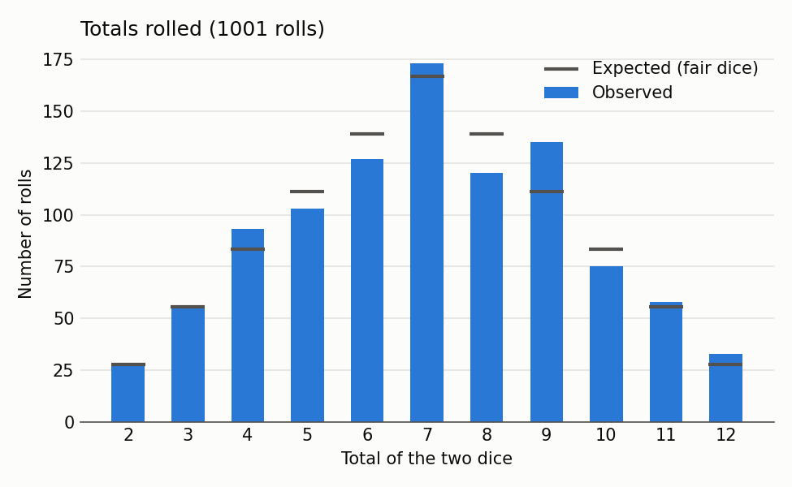

# Analysis Report

Generated by `scripts/analyze.py`: alpha = 0.05 per claim (reject when p <= alpha), seed = 20261101, 10,000 permutations, 10,000 bootstrap resamples.

Counted rolls: 1000; machines: A; analysis blocks: 1; gaps: 0.

## Descriptive statistics

Data quality: 999 rolls verified live, 1 corrected at a 10-roll check, 1 recovered from the history display (including each machine's row 0), 0 gap(s). Full counts are in `results/validation_summary.md`.

| Statistic of the total | Observed | Fair dice |
|---|---|---|
| Mean | 7.04 | 7.00 |
| Median | 7.0 | 7.0 |
| Mode | 7 | 7 |
| Standard deviation | 2.46 | 2.42 |

**Frequency of totals** (1001 rolls, all machines):

| Total | Observed | Expected | Observed % | Expected % |
|---|---|---|---|---|
| 2 | 28 | 27.8 | 2.80% | 2.78% |
| 3 | 56 | 55.6 | 5.59% | 5.56% |
| 4 | 93 | 83.4 | 9.29% | 8.33% |
| 5 | 103 | 111.2 | 10.29% | 11.11% |
| 6 | 127 | 139.0 | 12.69% | 13.89% |
| 7 | 173 | 166.8 | 17.28% | 16.67% |
| 8 | 120 | 139.0 | 11.99% | 13.89% |
| 9 | 135 | 111.2 | 13.49% | 11.11% |
| 10 | 75 | 83.4 | 7.49% | 8.33% |
| 11 | 58 | 55.6 | 5.79% | 5.56% |
| 12 | 33 | 27.8 | 3.30% | 2.78% |

**Frequency of dice combinations:**

| Combination | Observed | Expected |
|---|---|---|
| 1-1 | 28 | 27.8 |
| 1-2 | 56 | 55.6 |
| 1-3 | 69 | 55.6 |
| 1-4 | 46 | 55.6 |
| 1-5 | 52 | 55.6 |
| 1-6 | 52 | 55.6 |
| 2-2 | 24 | 27.8 |
| 2-3 | 57 | 55.6 |
| 2-4 | 50 | 55.6 |
| 2-5 | 68 | 55.6 |
| 2-6 | 43 | 55.6 |
| 3-3 | 25 | 27.8 |
| 3-4 | 53 | 55.6 |
| 3-5 | 51 | 55.6 |
| 3-6 | 71 | 55.6 |
| 4-4 | 26 | 27.8 |
| 4-5 | 64 | 55.6 |
| 4-6 | 43 | 55.6 |
| 5-5 | 32 | 27.8 |
| 5-6 | 58 | 55.6 |
| 6-6 | 33 | 27.8 |

**Game phase of counted rolls:** 298 come-out, 702 point set, 0 unknown (excluded from H3).

## Sanity check: fair-dice totals

- Machine A: chi-square = 12.59 (df = 10), p = 0.2474, 1001 rolls. No significant difference from fair dice.

## H1 (primary): excess exact-combination repeats

- Observed: 43 repeats in 1000 pairs (4.30%; 95% CI [3.43%, 5.53%]).
- Permutation baseline: 5.10% (fair dice: 5.09%). Difference: -0.80 percentage points.
- One-sided permutation p = 0.8894. **Fail to reject the null hypothesis.**

## H2 (secondary, gated): excess same-total repeats

- Observed: 113 repeats in 1000 pairs (11.30%; 95% CI [9.52%, 13.43%]).
- Permutation baseline: 11.08% (fair dice: 11.27%). Difference: +0.22 percentage points.
- Not formally tested because H1 was not significant (gatekeeping). Reported descriptively only.

## H3 (secondary): badly timed sevens

- Point-set rolls: 122 sevens in 702 (17.38%; 95% CI [14.71%, 19.44%]).
- Come-out rolls: 51 sevens in 298 (17.11%; 95% CI [13.99%, 20.80%]).
- Difference: +0.26 percentage points (95% CI [-3.93%, 3.42%]).
- One-sided two-proportion z = 0.10, p = 0.4597.
- **Fail to reject the null hypothesis.**
- Sensitivity (come-out rolls not right after a 7): difference +2.98 points, one-sided p = 0.2066.

## Exploratory: 7 rate in each phase vs. the fair rate of 1/6

One-sided exact binomial tests, reported without a reject/fail-to-reject decision. High in the point phase only points to timing; high in both phases points to too many 7s overall.

| Phase | Sevens | Rolls | Rate | Fair rate | One-sided p |
|---|---|---|---|---|---|
| Point set | 122 | 702 | 17.38% | 16.67% | 0.3211 |
| Come-out | 51 | 298 | 17.11% | 16.67% | 0.4418 |

## Notes

- H1/H2 (repeats) and H3 (sevens) are separate claims, each tested at alpha = 0.05 with no correction across them (see "Multiple comparisons" in `docs/preregistration.md`). If both nulls are true, the chance of at least one false positive is about 9.75%. The Bonferroni lines show whether each significant result would also pass alpha = 0.025.
- A non-significant result means "fail to reject the null hypothesis," not that the machine is fair.
- A significant result is evidence of a pattern on this machine during this session, worth replicating; it is not proof that the machine is rigged.
