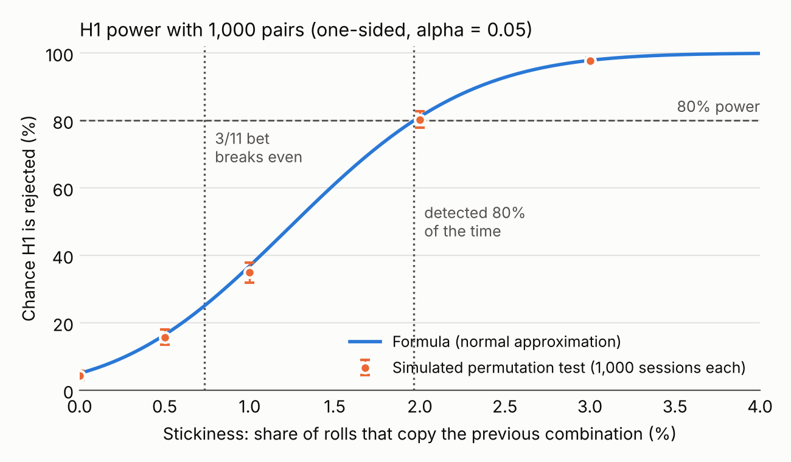
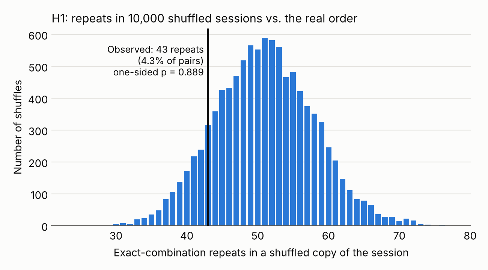
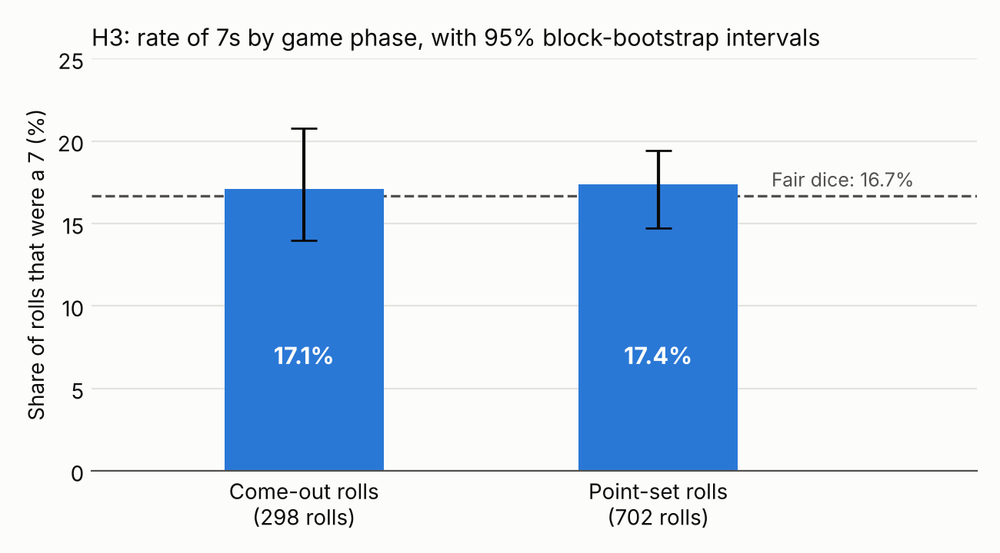

# Supplementary Analysis Report

Generated by `scripts/supplementary_analysis.py`: seed = 20261101, 10,000 permutations, 10,000 bootstrap resamples.

These analyses support the written report. **None of them changes a confirmatory decision**, which come only from `scripts/analyze.py` (see `results/analysis_report.md`). The script re-runs that analysis with the same seed: H1 one-sided p = 0.8894, H3 one-sided p = 0.4597; both fail to reject.

## 1. Effect sizes for the pre-registered comparisons

*Role: descriptive; added after data collection to meet the reporting requirements.* For H1 and H2, Cohen's h is the standardized gap between the observed repeat rate and the shuffled baseline. It describes the size of the difference; the permutation test remains the formal inference, because adjacent pairs overlap.

Benchmarks (Cohen, 1988): h 0.2 small, 0.5 medium, 0.8 large; w 0.1 small, 0.3 medium, 0.5 large.

| Comparison | Observed | Reference | Difference | Effect size |
|---|---|---|---|---|
| H1 exact-combination repeats | 4.30% | 5.10% (shuffled baseline) | -0.80 points | h = -0.038; rate ratio 0.84 |
| H2 same-total repeats (descriptive) | 11.30% | 11.08% (shuffled baseline) | +0.22 points | h = 0.007 |
| H3 7s, point set vs. come-out | 17.38% | 17.11% | +0.26 points | h = 0.007; risk ratio 1.02; odds ratio 1.02 |
| H3 check (come-outs after a non-7) | 17.38% | 14.40% | +2.98 points | h = 0.082; risk ratio 1.21; odds ratio 1.25 |
| Sanity check: totals vs. fair dice | chi-square = 12.59 | 1001 rolls | | w = 0.112 |

**95% intervals: preregistered block bootstrap vs. textbook intervals assuming independent rolls** (*added after data collection, as a reporting check*). The block bootstrap resamples overlapping 50-roll windows: any of the 952 possible starting points can be drawn, and each resample strings together 21 windows. A single session holds only about 20 non-overlapping 50-roll stretches of independent information, though, so the bootstrap's estimate of spread is itself noisy; here it is mostly narrower than the independence-based intervals. No conclusion depends on which is used.

| Quantity | Estimate | Block bootstrap | Assuming independence |
|---|---|---|---|
| H1 exact-repeat rate | 4.30% | [3.43%, 5.53%] | [3.13%, 5.75%] (exact Clopper-Pearson) |
| H2 same-total repeat rate | 11.30% | [9.52%, 13.43%] | [9.40%, 13.43%] (exact Clopper-Pearson) |
| 7 rate, point-set rolls | 17.38% | [14.71%, 19.44%] | [14.65%, 20.39%] (exact Clopper-Pearson) |
| 7 rate, come-out rolls | 17.11% | [13.99%, 20.80%] | [13.02%, 21.88%] (exact Clopper-Pearson) |
| Difference (point set minus come-out) | 0.26% | [-3.93%, 3.42%] | [-4.85%, 5.38%] (unpooled Wald) |

## 2. What the data rule out (H1)

*Role: added after data collection (planned in earlier drafts; the final preregistration specifies two-sided intervals).*

- Observed exact-repeat rate 4.30%; shuffled baseline 5.10%.
- One-sided 95% upper bound: 5.33% (moving-block bootstrap, the preregistered interval method); 5.51% (exact binomial, treating pairs as independent).
- In stickiness terms: at most 0.25% of rolls copying the previous combination (bootstrap); 0.43% (exact).

The table below compares these bounds with the overall repeat rate each strategy bet would need to break even. **It applies only under the equal-stickiness model (if the machine is streaky, it copies every combination equally often, as assumed in the design).**

| Strategy bet | Payout | Break-even win rate | Stickiness needed | Overall repeat rate needed | Upper bound below this rate? (bootstrap / exact) |
|---|---|---|---|---|---|
| Same 2 or 12 again | 30 to 1 | 3.23% | 0.46% | 5.53% | yes / yes |
| Same 3 or 11 again | 15 to 1 | 6.25% | 0.74% | 5.79% | yes / yes |

A "yes" means that, if any stickiness affected every combination equally, the data are inconsistent at the one-sided 5% level with enough stickiness for that bet to break even. It does **not** show that either bet is unprofitable: the conclusion rests on the equal-stickiness model, and the direct estimates of repeats after a 2 or 12 and after a 3 or 11 (section 5) have wide intervals that include the break-even rates. Break-even rate minus exact bound: 2 or 12: +0.02 points, 3 or 11: +0.28 points. For the 2 or 12 bet, the margin is too small to call.

## 3. Power for the design actually run

This is a sensitivity analysis for the achieved design: it restates the smallest effect each test detects with the sample actually collected. It is not post hoc "observed power", which would plug in the observed effect and only restate the p-value.

One-sided alpha = 0.05 and 80% power, normal approximation with Cohen's h (equivalent to statsmodels' `NormalIndPower`). The last column is the preregistration's quicker approximation, which uses the standard error under the null only and so gives slightly smaller values.

| Test | Sample | Fair value | Smallest effect detected 80% of the time | h | Two-sided | Bonferroni 0.025 | Preregistration approx. |
|---|---|---|---|---|---|---|---|
| H1 exact repeats | 1,000 pairs | 5.09% | 6.96% (stickiness 1.97%) | 0.079 | 7.21% | 7.21% | 6.82% |
| H2 total repeats | 1,000 pairs | 11.27% | 13.87% (stickiness 2.93%) | 0.079 | 14.21% | 14.21% | 13.75% |
| H3 point set vs. come-out | 702 vs. 298 rolls | 16.67% | point-set rate 23.53% (+6.9 points) | 0.172 | 24.46% | 24.46% | 23.07% |
| H3 check | 702 vs. 125 rolls | 16.67% | point-set rate 26.54% (+9.9 points) | 0.241 | 27.90% | 27.90% | 25.66% |
| Exploratory: point-set 7s vs. 1/6 | 702 rolls | 16.67% | 20.31% | 0.094 | | | |

The stickiness at which the 3/11 bet breaks even (0.74%, an overall repeat rate of 5.79%, h = 0.031) would be detected only 25% of the time with this sample; 80% power would need about 6,526 pairs.

The formulas treat pairs as independent. Under independence, overlapping pairs (which share a roll) raise the variance of the repeat count by only 0.4% for combinations and 3.2% for totals; section 4 checks the tests directly.

## 4. Simulation check of the tests

*Role: checks how the tests behave; not an analysis of the data.*

H1: 1,000 simulated sessions of fair dice per row (1,001 rolls, 999 shuffles each), in which each roll copies the previous combination with the stated probability.

| Stickiness | Repeat rate | Rejected (simulated) | Monte Carlo SE | Formula |
|---|---|---|---|---|
| 0.0% | 5.09% | 4.4% | 0.6% | 5.0% |
| 0.5% | 5.57% | 15.7% | 1.2% | 16.4% |
| 1.0% | 6.04% | 34.9% | 1.5% | 36.9% |
| 2.0% | 6.99% | 80.3% | 1.3% | 81.1% |
| 3.0% | 7.94% | 97.8% | 0.5% | 97.9% |

A recording error that copies the previous entry with probability e produces exactly this sequence model, so the same rows show how often copy errors at rate e would make H1 falsely significant.

H3: dynamic simulated pass-line sessions of 1,000 rolls, each starting on a come-out roll. The power formula in section 3 fixes the split at 702 point-set and 298 come-out rolls. Here each session produces its own split from the rules of the game, and extra point-set 7s end rounds sooner, so the elevated scenario averages 339 come-out rolls. These rows check how the test behaves in realistic sessions (its operating characteristics); they are not an exact check of the fixed-split calculation.

| Point-set 7 rate | Rejected (simulated) | Monte Carlo SE | Mean come-out rolls | SD of the difference in 7 rates |
|---|---|---|---|---|
| 16.7% | 5.2% | 0.4% | 297 | 2.59 points |
| 23.5% | 82.6% | 0.6% | 339 | 2.58 points |

With fair dice, the simulated spread of the difference (2.59 points) is close to the independence-based (Wald) standard error (2.61 points) and wider than the block bootstrap implies (about 1.88 points), so the Wald interval in section 1 is the safer reading for H3.

## 5. Exploratory analyses (no reject / fail-to-reject decisions)

Each item is tagged *listed in the preregistration* (named as exploratory in `docs/preregistration.md`) or *added after data collection* (chosen after seeing the data; hypothesis-generating only).

**Repeats after the strategy's numbers** (exact 95% intervals; *listed in the preregistration as betting-strategy estimates*):

| After a... | Rolls following | Same total again | Rate [95% CI] | Fair | Break-even |
|---|---|---|---|---|---|
| 2 or 12 | 60 | 1 | 1.7% [0.0%, 8.9%] | 2.8% | 3.2% |
| 3 or 11 | 114 | 3 | 2.6% [0.5%, 7.5%] | 5.6% | 6.2% |

- **Weighted repeat count** (*added after data collection; a supporting check in planning drafts, not in the final preregistration*; a repeated double counts 2, any other repeat 1): observed 47, shuffled mean 55.6, one-sided p = 0.876.
- **Consecutive rolls sharing at least one face** (*listed in the preregistration as shared die faces*; single sticky die): 52.2% observed vs. 51.3% in shuffles (fair dice 51.4%); one-sided p = 0.291.
- **First vs. second half** (*listed in the preregistration as early vs. late*): exact-repeat rate 4.0% vs. 4.6% (Fisher two-sided p = 0.76); point-set 7 rate 17.0% vs. 17.8% (p = 0.84).
- **Combination frequencies** (*added after data collection*; 21 categories, 1001 rolls): chi-square = 23.09, df = 20, p = 0.284, w = 0.152.
- **Face frequencies** (*added after data collection*; 2002 faces): chi-square = 4.94, df = 5, p = 0.424, w = 0.050; counts 1: 331, 2: 322, 3: 351, 4: 308, 5: 357, 6: 333.

**Repeats by combination** (descriptive; *listed in the preregistration as individual combinations*):

| Combination | Times as previous roll | Repeated | Expected (fair) |
|---|---|---|---|
| 1-1 | 28 | 0 | 0.8 |
| 1-2 | 56 | 1 | 3.1 |
| 1-3 | 69 | 4 | 3.8 |
| 1-4 | 46 | 3 | 2.6 |
| 1-5 | 52 | 4 | 2.9 |
| 1-6 | 52 | 3 | 2.9 |
| 2-2 | 24 | 0 | 0.7 |
| 2-3 | 57 | 4 | 3.2 |
| 2-4 | 50 | 1 | 2.8 |
| 2-5 | 68 | 5 | 3.8 |
| 2-6 | 43 | 2 | 2.4 |
| 3-3 | 25 | 1 | 0.7 |
| 3-4 | 53 | 3 | 2.9 |
| 3-5 | 51 | 1 | 2.8 |
| 3-6 | 71 | 1 | 3.9 |
| 4-4 | 26 | 1 | 0.7 |
| 4-5 | 64 | 3 | 3.6 |
| 4-6 | 43 | 2 | 2.4 |
| 5-5 | 32 | 1 | 0.9 |
| 5-6 | 58 | 2 | 3.2 |
| 6-6 | 32 | 1 | 0.9 |

## 6. Data-quality check: pass-line balance replay

*Role: data-quality check (see docs/deviations.md); the win rate is descriptive, added after data collection.*

Replaying a $3 pass-line bet on every come-out roll from $100 gives an ending balance of $40 (recorded: $40; matches). 298 rounds were decided: 139 won, 159 lost (win rate 46.6%, exact 95% CI [40.9%, 52.5%]; fair 49.3%). Lowest balance during the session: $22. Bet still open at the end: no.

## Figures

